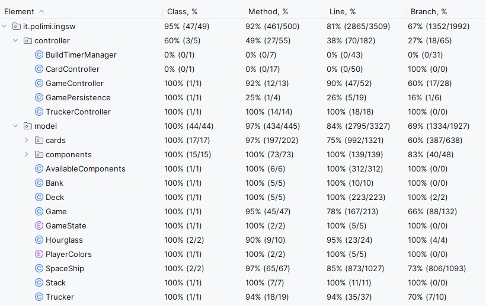

# SOFTWARE ENGINEERING PROJECT 2024/2025

Students: *Lorusso Luca, Manzoni Nicola, Martorano Gabriele, Morciano Francesca*

Teacher: *San Pietro Pierluigi*

## *Galaxy Trucker*

The project consists of a Java version of the board game Galaxy Trucker, made by Cranio Creations

**Game rules** [(English)](deliverables/readmeFiles/galaxy-trucker-rules-en.pdf) [(Italian)](deliverables/readmeFiles/galaxy-trucker-rules-it.pdf)

## Project specification

[Project requirements](deliverables/readmeFiles/requirements.pdf)

The final version of the game includes:
- high-level, general UML diagram;
- detailed UML diagram, generated from the code by automated tools;
- java documentations
- working game implementation;
- source code of the implementation;
- source code of tests.

### List of advanced functionalities
|**Functionality**          | **Implemented** |
|---------------------------|-----------------|
|Complete rules             | ✅               |
|Socket                     | ✅               |
|RMI                        | ✅               |
|CLI                        | ✅               |
|GUI                        | ✅               |
|Trial flight               | ✅               |
|Persistency                | ✅               |
|Multiple Games             | ❌               |
|Resilience to disconnection| ❌               |

Percentage of *model* and *controller* test coverage

JavaDoc of the project

## How to use

This section contains all instructions about how to run this project.

From the terminal (mac) or shell (windows) go in the deliverables/final/jar repository. Then, in differents windows 
(one for the server and as many as the players for the clients) type the following prompt: 
    
    java -jar client-app.jar (to run the client)

    java -jar server-app.jar (to run the server)

Then select the type of connection and User Interface method and enjoy the game.

